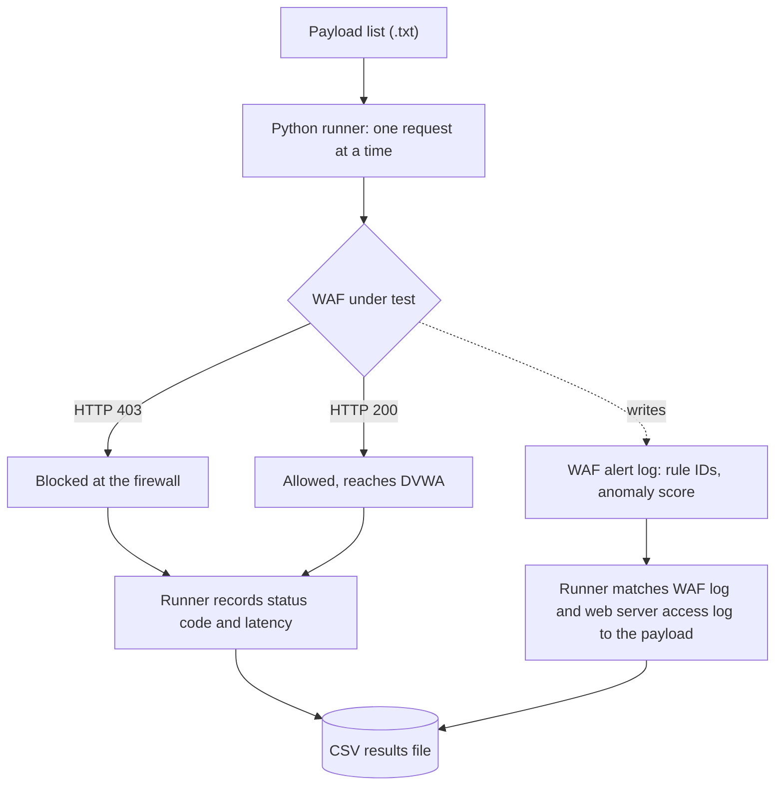

# Investigation and Evaluation of Open-Source Web Application Firewalls

A web application firewall (WAF) raising an alert does not mean it stopped the attack. This project measures that gap. We tested **ModSecurity** (with the OWASP Core Rule Set) and **NAXSI** against more than 20,000 attack payloads in an isolated lab. For every request we recorded whether the firewall blocked it, logged it but let it through, or missed it.

Curtin University | COMP6016 Capstone Project | Group 6

**Full results and analysis:** [Final Comparative Evaluation Report (PDF)](./docs/Final_WAF_Comparison_Report.pdf). This README covers the headline results, how the testing was done, and how to reproduce it.

## At a glance

- **Firewalls tested:** ModSecurity with the OWASP Core Rule Set (CRS) and NAXSI, with Coraza as an extended comparison
- **Attack classes:** SQL injection, cross-site scripting (XSS, reflected and stored), path traversal, XML external entity (XXE) injection
- **Scale:** 20,000+ payloads from public collections, each sent as its own request
- **Recorded per request:** HTTP status, latency, whether any rule fired, whether the request was blocked, and the rule IDs involved
- **Lab:** isolated host-only network with a Kali Linux attacker and Ubuntu, Windows Server and Windows 11 targets running DVWA (a deliberately vulnerable practice web application)
- **Tools and skills:** Python, Bash, cURL, Linux, Apache, Nginx, ModSecurity, OWASP CRS, NAXSI, log analysis, Git, Jira

## Key findings

1. **An alert is not a block.** ModSecurity with the CRS raised an alert on all 7,229 SQL injection payloads but blocked only 3,609 of them (49.92%). The other 3,620 received HTTP 200 and reached the application. Counting alerts gives 100%. Counting blocks gives 49.92%.
2. **XSS was fully blocked.** All 10,000 XSS payloads (5,000 reflected through GET and 5,000 stored through POST) were rejected with HTTP 403.
3. **ModSecurity compared with NAXSI.** TODO: one or two sentences with your main comparison result and the numbers behind it.

## My contribution

This was a team project. My part:

- TODO: what you built or ran (for example the test runner for one attack class, the log parser, or the lab setup)
- TODO: the results or analysis you were responsible for
- TODO: one technical problem you diagnosed or decision you made

<details>
<summary><strong>New to WAFs? A short primer on the terms used here</strong></summary>

**Payload.** The malicious input sent in a request, for example database commands typed into a login field.

**Web application firewall (WAF).** A traditional network firewall decides by IP address and port. A WAF reads the content of web requests (form fields, URL parameters, headers) and drops the ones that look like attacks before the application processes them.

**OWASP Top 10 and the Core Rule Set (CRS).** The Open Worldwide Application Security Project (OWASP) publishes a widely used ranking of the most serious web application risks, such as injection flaws and broken access control. ModSecurity is an inspection engine and needs rules to work. The CRS is a free rule set for it that targets those risks.

**How a request is scored.** With the CRS, each matching rule adds penalty points: Critical 5, Error 4, Warning 3, Notice 2. A request is blocked only when its total reaches the blocking threshold, which defaults to 5. A request that matches only low-scoring rules is logged but still goes through.

**Outcomes used in this project**

- **Blocked:** the firewall rejected the request (HTTP 403 Forbidden). It never reached the application.
- **Allowed:** the request passed through and the application processed it (HTTP 200 OK).
- **Alerted but allowed:** at least one rule fired, but the score stayed below the blocking threshold.
- **False negative (bypass):** an attack request that reached the application.
- **False positive:** a legitimate request that was wrongly blocked.

</details>

## Results

### Across all attack classes

| Attack class | Payloads | ModSecurity + CRS: blocked | NAXSI: blocked |
|---|---:|---|---|
| SQL injection | 7,229 | 3,609 (49.92%) | TODO |
| XSS, reflected (GET) | 5,000 | 5,000 (100%) | TODO |
| XSS, stored (POST) | 5,000 | 5,000 (100%) | TODO |
| Path traversal | TODO | TODO | TODO |
| XXE | TODO | TODO | TODO |

"Blocked" means the request received HTTP 403. Per-request data for every cell is in the `results/` folder of each attack class. Graphs, rule-level log analysis and the full cross-firewall comparison are in the [report](./docs/Final_WAF_Comparison_Report.pdf).

<!-- OPTIONAL: save a bar chart of blocked vs allowed per attack class and firewall as docs/images/results.png, then add it here with  -->

### SQL injection: ModSecurity with the OWASP CRS

| Measure | Requests | Share |
|---|---:|---:|
| Payloads sent | 7,229 | 100% |
| At least one rule fired (alert) | 7,229 | 100.00% |
| Blocked (HTTP 403) | 3,609 | 49.92% |
| Allowed (HTTP 200) | 3,620 | 50.08% |

Every request triggered at least one rule, yet half of them were allowed. Many of the allowed payloads matched only low-severity rules (protocol warnings or partial matches), so their combined anomaly score stayed under the blocking threshold of 5. These are the cases where the firewall logs an attack and still lets it through. We report alerts and blocks separately throughout for this reason.

### XSS: ModSecurity with the OWASP CRS

| Variant | Payloads | Blocked |
|---|---:|---:|
| Reflected (GET) | 5,000 | 5,000 (100%) |
| Stored (POST) | 5,000 | 5,000 (100%) |

The CRS XSS rules (the 941xxx family) blocked every payload in the set, including script tags, event-handler injections and obfuscated variants. A perfect score on a public payload list shows strong coverage of known XSS patterns. It does not show that the firewall stops all XSS (see [Limitations](#limitations)).

## How the testing was done

### Why custom scripts instead of vulnerability scanners

In an earlier unit (COMP6015) we generated attack traffic with OWASP ZAP, Nikto and sqlmap. Those logs are kept in `ZAP_Attack_Logs/`. Scanners are good for broad coverage but poor for benchmarking:

- They send bursts of simultaneous requests, so a log entry cannot be tied to the payload that caused it.
- They can saturate the virtual machine's network interface, and a dropped connection then looks like a firewall block.
- They do not let you test individual payloads or hand-made evasion variants.

For the capstone we replaced them with single-request scripts in Python, Bash and cURL. Sending one payload at a time makes every result traceable and repeatable.

### Test pipeline



### Payload sources

- PortSwigger Web Security Academy (cheat sheets and manual testing techniques)
- SecLists
- PayloadsAllTheThings and payload-box (GitHub)
- DirBuster (`directory-list-2.3-big.txt`)
- Assetnote wordlists and Xfeed

### Attack classes tested

| Attack class | What it targets | Variants tested | OWASP Top 10 (2021) |
|---|---|---|---|
| SQL injection | Database queries built from user input | UNION-based extraction, boolean-based blind, time-based delays (`SLEEP()`, `BENCHMARK()`), authentication bypass | A03 Injection |
| Cross-site scripting | Scripts injected into pages other users view | Reflected through URL parameters (GET), stored through a message form (POST); obfuscated tags, event handlers, JavaScript sinks | A03 Injection |
| Path traversal | Files outside the web root | `../` sequences, URL-encoded (`%2e%2e%2f`), null-byte injection, nested encodings | A01 Broken Access Control |
| XXE | XML parsers that resolve external entities | External entity definitions used to read local files and trigger server-side request forgery (SSRF) | A05 Security Misconfiguration |

## Lab and configuration

### Environment

All machines sit on an isolated host-only network (`192.168.x.x/24`), so no test traffic left the lab.

| Role | System | Purpose |
|---|---|---|
| Attacker | Kali Linux VM (shared OVA image) | Runs the Python scripts, cURL commands and payload lists. Every team member used the same image, so tests ran under identical conditions. |
| Primary target | Ubuntu Server | DVWA on Apache 2.4 and Nginx, with ModSecurity and NAXSI integrated |
| Secondary targets | Windows Server, Windows 11 | DVWA, used to compare WAF behaviour and rule portability across operating systems |

DVWA was run at its Low, Medium and High security levels. TODO: state which level the headline numbers came from, and name the DVWA module or custom endpoint used for each attack class (DVWA has no built-in XXE module).

### Firewalls and configuration tested

| Firewall | What it is | Configuration tested |
|---|---|---|
| ModSecurity + OWASP CRS | Open-source WAF engine paired with the Core Rule Set, a large public rulebook for OWASP Top 10 attacks | Blocking threshold 5 (CRS default). TODO: ModSecurity version, CRS version, paranoia level, web server |
| NAXSI | WAF module for Nginx with a small core rule set. It scores suspicious characters and patterns and blocks when a set threshold is crossed. Usually tuned per application with whitelist rules | TODO: NAXSI and Nginx versions, block threshold, learning mode on or off, any whitelist rules |
| Coraza | WAF engine written in Go that can run the OWASP CRS | TODO: what was tested and where the results are |

## Repository layout

```text
open-source-firewall-evaluation/
├── modsecurity/            # ModSecurity + OWASP CRS test suites
│   ├── SQLi/
│   ├── XSS/                # reflected (GET) and stored (POST)
│   ├── Path_traversal/
│   └── XML_attack_XXE/
├── naxsi/                  # the same four suites run against NAXSI
│   ├── SQLi/
│   ├── XSS/
│   ├── Path_traversal/
│   └── XML_attack_XXE/
├── ZAP_Attack_Logs/        # earlier scanner-based test logs (OWASP ZAP)
├── OVA_Files/              # setup guide for the lab virtual machines
├── docs/                   # scoping, progress reports, final comparison report (PDF)
├── requirements.txt        # Python dependencies
└── README.md
```

Each attack folder contains:

- `payloads/`: plain text files of the attack strings tested
- `results/`: CSV output, one row per request
- `*.py`: the Python test runner for that attack class
- `*.docx` / `*.md`: technical notes on configuration, attack logic and findings

## Run it yourself

Requirements: Python 3.10 or later, and a lab target with a WAF in front of DVWA. The virtual machine images are too large for GitHub and are not in this repo. `OVA_Files/README.md` has the setup steps and download links.

```bash
git clone https://github.com/<your-username>/open-source-firewall-evaluation.git
cd open-source-firewall-evaluation
pip install -r requirements.txt

cd modsecurity/SQLi/
python3 run_sqli.py
```

Update the target address in the script to match your lab before running. Each run writes a CSV file to the attack class's `results/` folder.

### Output columns

| Column | Meaning | Example |
|---|---|---|
| `request_id` | Sequential ID for each request | `REQ-0004` |
| `payload` | Exact attack string sent | `445 UNION ALL SELECT NULL, NULL...` |
| `http_status` | Response code from the server | `403` (blocked) or `200` (allowed) |
| `waf_detected` | Whether any WAF rule fired | `Yes` |
| `waf_blocked` | Whether the request was dropped | `Yes` |
| `time_ms` | Round-trip time in milliseconds | `9.62` |
| `rules` | Rule IDs and descriptions that fired | `942100: SQL Injection Attack Detected...` |

## Limitations

- **Blocked or allowed is a request-level result.** An HTTP 200 shows a payload got past the firewall. It does not show the payload would have worked against DVWA. Public payload lists include strings written for other database engines or contexts, so the allowed count can overstate real bypasses.
- **Known payloads only.** Every payload comes from a public collection that rule authors also read. A 100% block rate on a list means strong coverage of known strings, not protection against new evasion techniques.
- **Results depend on configuration.** The numbers apply to the versions, rule sets and thresholds listed above. A different paranoia level, threshold or whitelist would change them.
- **No false-positive testing.** This work measures how attacks are handled. It does not measure how often legitimate traffic is wrongly blocked, which is the other half of judging a WAF.
- **Small, deliberately vulnerable target.** DVWA is a lab application. Real applications produce more varied traffic, and single sequential requests do not test behaviour under concurrent load.

## About this project

- **Unit:** COMP6016 Capstone Project, Curtin University
- **Supervisor:** Mihai Lazarescu
- **Group:** Group 6
- **Workflow:** GitHub for version control, scripts and datasets; Jira for sprint backlogs, user stories and task tracking

### Responsible use

The scripts and payload sets in this repository are for authorised testing in controlled environments. All testing here ran on an isolated host-only network against deliberately vulnerable software. Do not run them against systems you do not own or have written permission to test.

Created for academic research and education within the COMP6016 Capstone Project at Curtin University. All rights reserved.

### Contact

TODO: your name, LinkedIn link and email.
